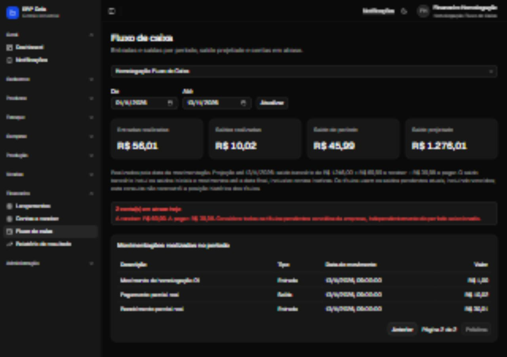
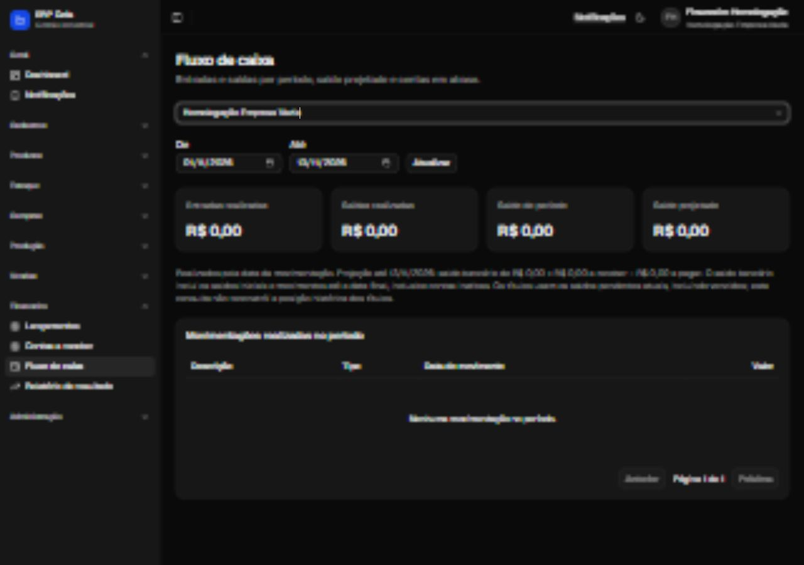
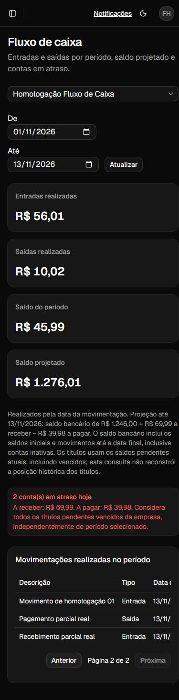

# Homologação do fluxo de caixa

Realizada em 13/11/2026 sobre o commit `0756d55`, no PR #144.

## Ambiente

Build de produção do Next.js executado localmente com MySQL real, em uma base
dedicada com sufixo `_test`. A estrutura foi copiada do MySQL local, sem copiar
os dados da empresa. Todas as empresas, usuários, títulos e movimentos desta
homologação são fictícios. A autenticação usou o fluxo real de login, Argon2,
JWT, refresh token e permissões financeiras; não houve mocks no HTTP ou no banco.

A cópia do banco local ainda não continha as migrations existentes
`20261105000000_plano_pagamento_compra` e `20261110000000_revogacao_sessoes`.
Elas foram aplicadas somente à base de teste antes da carga fictícia. O banco
original não foi alterado. Um ambiente que ainda não tenha essas migrations
precisa alinhá-las ao código antes da implantação; não são migrations novas
introduzidas por este PR.

Ao concluir, o servidor foi encerrado, as sessões foram finalizadas e a base e
a credencial temporárias foram removidas. As evidências abaixo foram preservadas.

## Conferência dos valores

Cenário com saldo inicial de R$ 1.000,01 em conta ativa e R$ 200,00 em conta
inativa. Uma conta cadastrada no mês seguinte, com R$ 9.000,00, deve ficar fora
da posição de novembro. Existem 26 entradas de R$ 1,00, um recebimento parcial
de R$ 30,01 e um pagamento parcial de R$ 10,02, totalizando 28 movimentos.

| Indicador | Até 13/11 | Até 30/11 |
| --- | ---: | ---: |
| Entradas realizadas | R$ 56,01 | R$ 56,01 |
| Saídas realizadas | R$ 10,02 | R$ 10,02 |
| Saldo do período | R$ 45,99 | R$ 45,99 |
| Saldo bancário | R$ 1.246,00 | R$ 1.246,00 |
| Pendente a receber | R$ 69,99 | R$ 269,99 |
| Pendente a pagar | R$ 39,98 | R$ 139,98 |
| Saldo projetado | R$ 1.276,01 | R$ 1.376,01 |

Os dois títulos parciais vencidos resultaram em duas contas em atraso, com
R$ 69,99 a receber e R$ 39,98 a pagar. Os títulos cancelados de R$ 500,00 em
cada direção foram excluídos das pendências. Todos os valores coincidiram
entre as expectativas da fixture, a resposta HTTP e a tela autenticada.

## Resultado dos cenários

- Login real, seleção de empresa e logout: aprovados.
- Indicadores, saldos parciais, cancelados, atrasos e projeção futura: aprovados.
- Paginação: 25 movimentos na primeira página e 3 na segunda, totais constantes;
  solicitação da página 99 normalizada para a página 2.
- Empresa vazia: todos os valores zerados, mensagem de ausência de movimentos,
  paginação desabilitada e nenhum dado da outra empresa.
- HTTP 401 sem sessão, 403 para empresa sem vínculo e 400 para data inválida ou
  filtro empresarial não aceito: aprovados, com respostas sem cache.
- Filtro de datas invertido: mensagem de validação, sem mostrar indicadores antigos.
- Troca entre empresas e alteração do período: indicadores atualizados corretamente.
- Perda de permissão na fixture: mensagem de erro e botão Tentar novamente.
  Após restaurar a permissão, a mesma tela recuperou os valores corretos.
- Layout desktop de 1280 × 900 e móvel de 390 × 844: sem sobreposição dos cards.
  No móvel, a página permaneceu com 390 px de largura; a tabela de 512 px ficou
  contida em sua área com rolagem horizontal.
- Console do navegador: nenhum erro capturado.
- GitHub Actions e Vercel para `0756d55`: sucesso; PR sem conflito de merge.

## Evidências visuais

Somente dados fictícios aparecem nas capturas.

## Limites da verificação

A homologação comprova o funcionamento com MySQL e autenticação reais em um
ambiente local isolado; não é um teste nos dados privados de produção.
A projeção continua usando as pendências atuais, conforme a regra mostrada na
tela, sem reconstruir a carteira histórica. A nova execução não substitui as
1.727 verificações unitárias que também passaram na revisão do mesmo commit.

## Revisão adicional de 13/11/2026

Foi reproduzida e corrigida uma mensagem enganosa no endpoint: uma falha interna
na validação da sessão mantinha HTTP 500, mas retornava "Acesso negado". Agora o
endpoint preserva a mensagem segura da autenticação, sem expor o erro interno.
Um teste de regressão cobre esse cenário.

As consultas de títulos, pagamentos, créditos e movimentos passaram a selecionar
somente os campos usados no relatório. Uma nova base MySQL isolada confirmou os
mesmos saldos atual e futuro, empresa vazia e bloqueio de empresa sem vínculo.
Também foi simulada nessa base a ausência de `contas_pagar.id_plano_pagamento`:
o relatório continuou funcionando, sem depender desse campo auxiliar de compras.
Isso não dispensa as migrations de compras para o restante do aplicativo.
A base e a credencial temporárias foram removidas após a conferência.

A suíte completa passou com 1.728 testes em 90 arquivos; os 27 testes específicos
do fluxo de caixa e sua formatação também passaram. Tipos, lint, formatação e
build com Webpack foram aprovados.
