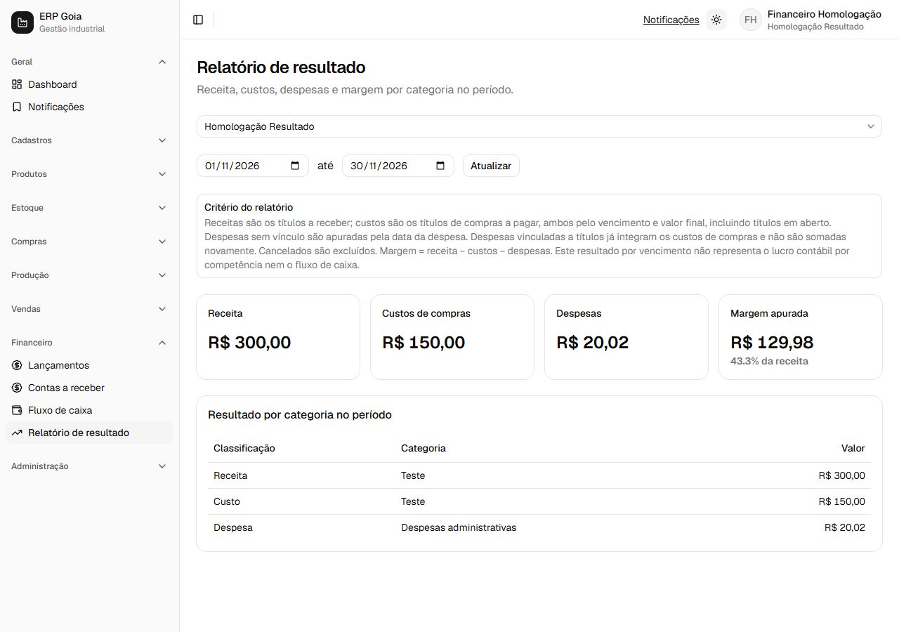
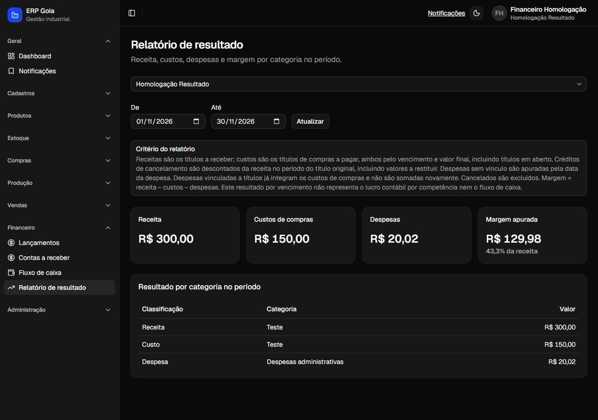
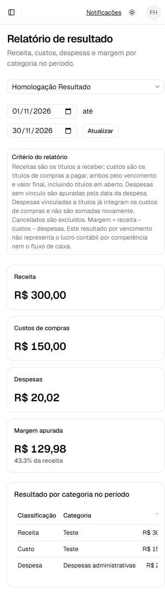
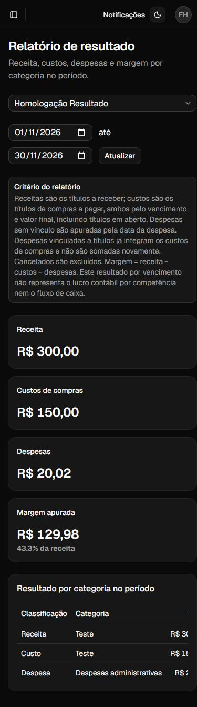
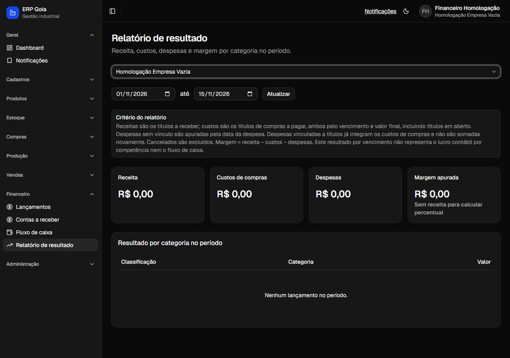
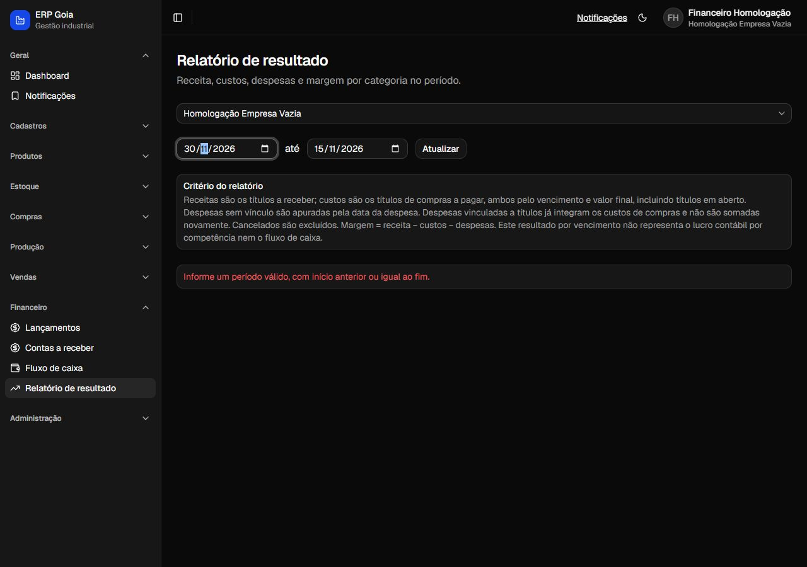

# Homologação do relatório de resultado

Realizada em 15/11/2026 na branch `feature/relatorio-resultado-real`, sobre a implementação do commit `35cd227`.

## Ambiente

Build de produção com Webpack, MySQL local isolado e dados inteiramente fictícios. Somente a estrutura do MySQL local foi copiada. As migrations existentes de plano de pagamento de compras e revogação de sessões foram aplicadas apenas à base descartável. Não houve alteração nos dados ou estrutura do banco original.

Login e logout usaram o fluxo real com Argon2, JWT e sessão persistida. As consultas HTTP não usaram mocks.

## Valores conferidos

| Indicador | 01/11 a 15/11 | 01/11 a 30/11 |
| --- | ---: | ---: |
| Receita | R$ 100,00 | R$ 300,00 |
| Custos de compras | R$ 50,00 | R$ 150,00 |
| Despesas | R$ 20,02 | R$ 20,02 |
| Margem | R$ 29,98 | R$ 129,98 |
| Margem percentual | 30,0% | 43,3% |

Valores conferidos na API e na tela autenticada. Títulos parciais são apurados pelo valor final integral. Títulos e despesas cancelados de R$ 500,00 ficaram fora do resultado. Uma despesa de R$ 50,00 vinculada à conta a pagar não duplicou os custos. A despesa de R$ 20,02 na data inicial também foi incluída quando o período continha somente esse dia.

## Cenários aprovados

- Empresa vazia: todos os valores zerados, percentual ausente e mensagem de nenhum lançamento; sem dados da outra empresa.
- Troca de empresa e alteração do período atualizam os totais.
- Período invertido mostra validação e remove os totais anteriores.
- API: 401 sem sessão, 403 para empresa sem vínculo e 400 para data inválida, período invertido ou filtro empresarial enviado na query; respostas sem cache.
- Temas claro e escuro no desktop de 1280 × 900 e no móvel de 390 × 844.
- No móvel, largura da página e do conteúdo de 390 px; tabela contida em sua área com rolagem horizontal.
- Nenhum aviso ou erro capturado no console durante a conferência.
- Logout pela interface e encerramento do ambiente temporário após a validação.

## Evidências

Somente registros fictícios aparecem nas imagens.

## Limites

A homologação foi local com MySQL real e dados fictícios, não nos dados privados de produção. Mantêm-se os [critérios e limites financeiros do relatório](../src/modules/resultado/README.md). O build com Webpack passou; o build padrão com Turbopack encontrou uma falha ao iniciar o subprocesso de CSS neste Windows. A configuração de build do projeto não foi alterada.

## Revisão dos créditos de cancelamento

A revisão posterior encontrou que o cancelamento parcial preserva `valor_final` e registra a redução em `pedido_credito_receber`. O relatório foi corrigido para descontar o valor integral desses créditos da receita da categoria, incluindo saldo anulado e valores a restituir. O reembolso posterior não é descontado novamente. Como o relatório usa o estado atual dos títulos, créditos lançados depois ajustam o período de vencimento original.

Uma nova base MySQL isolada confirmou dois créditos de R$ 10,01 e R$ 20,02 no mesmo título. A receita do mês passou de R$ 300,00 para R$ 269,97, e a margem de R$ 129,98 para R$ 99,95. Créditos registrados em dezembro ajustaram corretamente o vencimento de novembro. A empresa vazia continuou com receita zero. As capturas acima documentam a fixture original, sem créditos; os seus valores permanecem válidos nesse cenário.

A suíte completa passou com 1.888 testes; os 20 testes específicos incluem créditos múltiplos e rejeição de créditos inválidos ou superiores ao título.
